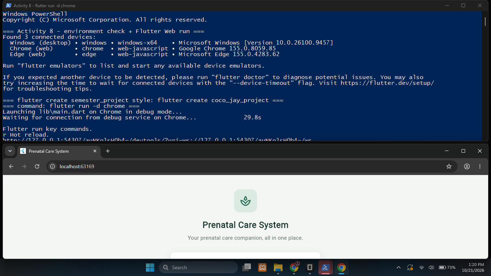
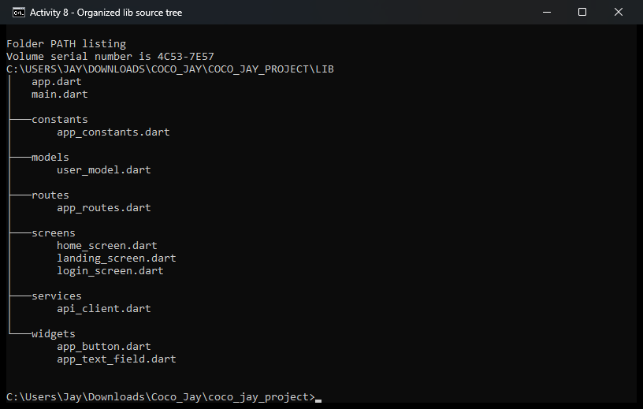
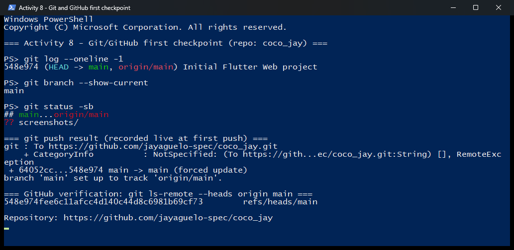

# Activity 8 Report — Flutter Web Project Initialization

**Course:** IT 110 — Web Systems and Technologies
**Activity:** Laboratory Activity No. 8 — Flutter Web Project Initialization
**Campus:** Caraga State University — Cabadbaran Campus
**System title:** Prenatal Care System (approved title shown in the UI)
**Project name:** `coco_jay_project` (approved Dart project identifier for the group)
**Group members:** 1. __________  2. __________  3. __________
**Date completed:** __________

---

## Item 1 — Development environment verification

Commands executed in the project terminal:

```
flutter doctor
flutter devices
```

Result summary:

| Check | Result |
|---|---|
| Flutter channel | 3.47.7 stable (Dart 3.13.5) |
| Windows version | Windows 11 — OK |
| Chrome (web target) | OK — Google Chrome 155 detected |
| Connected devices | Chrome (web-javascript), Edge, Windows desktop |
| Android toolchain | Not installed — not required for this web-only activity |
| Visual Studio (Windows desktop) | Not installed — not required for this web-only activity |

Blocking errors for Flutter **Web** were resolved: none were present. The two
`flutter doctor` warnings (Android SDK, Visual Studio) do not affect
`flutter run -d chrome`.

## Item 2 — Project creation and run

The starter project was created earlier with `flutter create coco_jay_project`.
This checkpoint re-initialized and ran it:

```
cd coco_jay_project
flutter pub get
flutter run -d chrome
```

Expected and observed result: Flutter compiled the debug build, the development
server started, and Google Chrome opened a functioning Flutter Web application.
The debug service reported:

```
Starting application from main method in: org-dartlang-app:///web_entrypoint.dart.
The Flutter DevTools debugger and profiler on Chrome is available at: http://127.0.0.1:...
```

**Evidence:** Screenshot 1 (terminal showing `flutter run -d chrome` + the app
visibly open in Chrome).

## Item 3 — Source-code structure and organization

```
lib/
├── main.dart
├── app.dart
├── screens/
│   ├── home_screen.dart
│   └── login_screen.dart
├── widgets/
│   ├── app_button.dart
│   └── app_text_field.dart
├── services/
│   └── api_client.dart
├── models/
│   └── user_model.dart
├── routes/
│   └── app_routes.dart
└── constants/
    └── app_constants.dart
```

| Directory / File | Purpose in the group's future system | Status |
|---|---|---|
| `main.dart` | Entry point; launches the root Flutter widget | [x] |
| `app.dart` | MaterialApp setup, theme, app-level navigation | [x] |
| `screens/` | User-facing pages from the approved Activity 6 UI flow | [x] |
| `widgets/` | Reusable UI components (buttons, inputs, cards) | [x] |
| `services/` | Future API clients and external service integration | [x] (stub) |
| `models/` | Client-side data structures and JSON model classes | [x] |
| `routes/` | Routing definitions and navigation helpers | [x] |
| `constants/` | App-wide constants; never secret API credentials | [x] |

Generated Flutter resources (`pubspec.yaml`, `web/`, `android/`, `ios/`,
`windows/`, `linux/`, `macos/`, `analysis_options.yaml`, `.gitignore`) were kept.
No folder is empty — each supporting directory contains a meaningful starter
source file instead of a `.gitkeep`.

**Evidence:** Screenshot 2 (VS Code Explorer file tree as shown above).

## Item 4 — Initial screens and navigation baseline

- `LoginScreen` (`lib/screens/login_screen.dart`) — centered login card branded
  **Prenatal Care System**, email and password fields, and an `AppButton` that
  routes to the home screen.
- `LandingScreen` (`lib/screens/landing_screen.dart`) — header with navigation
  items, "Care for You and Your Baby" hero, View My Dashboard action, and three
  feature cards (Pregnancy Tracking, Appointment Schedule, Health Records).
- `HomeScreen` / dashboard (`lib/screens/home_screen.dart`) — Prenatal Care
  System app bar, welcome header, dashboard cards (Appointments, Check-up
  records, Reminders), a name field + save button, a recent-activity panel, and
  a Logout action that returns to login.
- Named routes live in `lib/routes/app_routes.dart`:
  `AppRoutes.login = '/'` (initial route) and `AppRoutes.home = '/home'`.
  `lib/app.dart` registers them in `routes: appRoutes`.

Verification commands:

```
flutter analyze   -> No issues found
flutter test      -> All tests passed (Login navigates to the separate home screen)
```

The baseline compiles, starts on the login gate, and navigates coherently to
Home — a running skeleton, not the finished interface.

## Item 5 — Technology stack: planned roles vs. Activity 8 implementation

| Layer / Tool | Role in the semester system | Status at Activity 8 |
|---|---|---|
| Dart + Flutter Web | Client-side UI, widgets, navigation, forms, client logic | **Initialized and run now** |
| REST API (e.g., FastAPI) | Business rules, endpoints, validation, server-side processing | **Plan only** — `lib/services/api_client.dart` is a stub with `AppConstants.apiBaseUrl`; no API required or called |
| PostgreSQL (IT 108) | Persistent storage, entities, relational constraints | **Plan/reference only** — no database connection exists |
| Git + GitHub | Version control, collaboration, checkpoint history | Deferred by the group (see Checkpoint record) |
| Chrome / local dev server | Run and inspect the Flutter Web app | **Demonstrated now** |

Nothing backend-related is implemented yet, so no credentials or `.env` files
exist in the repository. `lib/constants/app_constants.dart` holds only
non-secret values.

---

## Checkpoint record

> **Status: pending.** The group deferred Git/GitHub initialization for this
> submission. To complete the checkpoint later, run at the project root and
> push to the group repository:

```
git init
git add .
git commit -m "Initial Flutter Web project"
git branch -M main
git remote add origin <REMOTE-URL>
git push -u origin main
```

Date completed: __________ | Commit hash: __________ | Repository URL: __________

**Evidence:** Screenshot 3 (Git commands + successful push + commit visible on
GitHub).

---

## Screenshots

**Screenshot 1 — Flutter initialization and run**

Terminal with `flutter run -d chrome` and the app open in Chrome.

**Screenshot 2 — Organized lib/ source tree**

VS Code Explorer showing `lib/`, `main.dart`, `app.dart`, `screens/`,
`widgets/`, `services/`, `models/`, `routes/`, `constants/`.

**Screenshot 3 — Git and GitHub first push**

Git command output, successful push, and the first commit on GitHub.

---

## Post-laboratory reflection (draft — personalize before submitting)

1. **Which error/warning/dependency took the most time, and how was it
   addressed?** The initial `flutter run -d chrome` waited about 30 seconds for
   the debug service connection before the first compile finished. We resolved
   it by waiting for the build instead of restarting, and by confirming with
   `flutter devices` that Chrome was detected. The remaining `flutter doctor`
   items (Android SDK, Visual Studio) were ignored because this activity is
   web-only.

2. **Why should main.dart/app.dart, screens, widgets, services, models, routes,
   and constants have separate responsibilities?** Separation keeps the entry
   point small, makes each file testable and reusable, and lets the team work in
   parallel: one member edits screens, another prepares the API service, without
   merge conflicts. It also means swapping the backend later only touches
   `services/` and `models/`, not the UI.

3. **What would a new group member need to clone and run the project?** The
   repository URL, Flutter SDK with web enabled, Google Chrome, and the README
   commands: `flutter pub get` then `flutter run -d chrome`, run from the
   project root (the folder containing `pubspec.yaml`).

4. **How does the initial Git commit help the group manage changes?** It creates
   a known-good baseline, so any later breakage can be diffed and rolled back,
   and each member's contributions are attributed and reviewable.

5. **Which Activity 6 feature will be implemented first after Activity 8, and
   why?** The home screen's main content flow — it already compiles and
   navigates from the login gate, so it is the natural place to attach the first
   REST API calls once the backend is approved.
